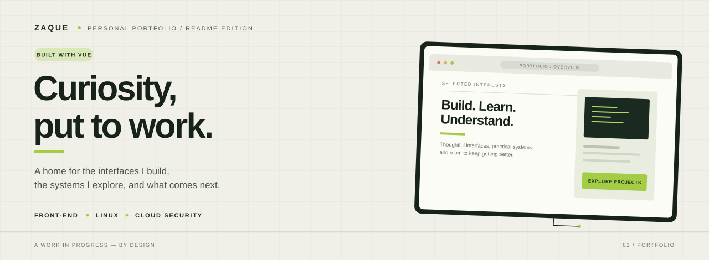

  
   
   
  

    
    
    
  

  
AN OPEN WINDOW INTO WHAT I BUILD, WHAT I EXPLORE, AND WHAT I'M LEARNING.

 

<table>
  <tr>
    <td width="58%" valign="top">
      <h2>01 &nbsp; / &nbsp; The idea</h2>
      
This is my corner of the web: a portfolio made to bring my projects, interests, and approach to building things together in one place.

      
I'm interested in interfaces that feel considered, systems that make sense, and the details that turn something merely functional into something genuinely good to use.

    </td>
    <td width="42%" valign="top">
      <h2>Project notes</h2>
      <table>
        <tr><td>TYPE</td><td>Personal portfolio</td></tr>
        <tr><td>FRAMEWORK</td><td>Vue.js</td></tr>
        <tr><td>FOCUS</td><td>Front-end · Linux · Cloud security</td></tr>
        <tr><td>APPROACH</td><td>Clarity over noise</td></tr>
      </table>
    </td>
  </tr>
</table>

---

## 02 &nbsp; / &nbsp; What's inside

<table>
  <tr>
    <td width="25%" valign="top">
      01 — INTRODUCTION
      <h3>About me</h3>
      A little context about the person behind the work.
    </td>
    <td width="25%" valign="top">
      02 — THE TOOLBOX
      <h3>Tech stack</h3>
      The tools and technologies I use and keep exploring.
    </td>
    <td width="25%" valign="top">
      03 — THE WORK
      <h3>Projects</h3>
      Selected builds, experiments, and progress in public.
    </td>
    <td width="25%" valign="top">
      04 — SAY HELLO
      <h3>Contact</h3>
      A straightforward way to get in touch.
    </td>
  </tr>
</table>

These sections are designed to work together: not just to show what I know, but to give a clearer sense of what I'm curious about and where I'm heading.

---

## 03 &nbsp; / &nbsp; Design direction

<table>
  <tr>
    <td width="33%" valign="top">
      <h3>Quiet structure</h3>
      
Clear hierarchy and deliberate spacing keep the content easy to follow.

    </td>
    <td width="33%" valign="top">
      <h3>Personal, not precious</h3>
      
A visual identity with character, without getting in the way of the work.

    </td>
    <td width="33%" valign="top">
      <h3>Always evolving</h3>
      
The portfolio can grow as I learn, build, and find better ways to do things.

    </td>
  </tr>
</table>

---

## 04 &nbsp; / &nbsp; Built with

  

Vue is the foundation of this project. The rest of the stack is documented in the portfolio itself, alongside the technologies I use and explore.

---

## 05 &nbsp; / &nbsp; A note on the work

This portfolio is part showcase, part work in progress. It isn't meant to suggest that I've finished learning; it's a record of what I'm making now and a place to make the next version better.

   
  DESIGNED TO BE USEFUL. BUILT TO KEEP GROWING.
   
   
  <a href="https://github.com/zaquea">GITHUB PROFILE ↗</a>

<!-- Before publishing: add the live portfolio URL above if you want a demo link, and update this README when the stack or project structure changes. -->
